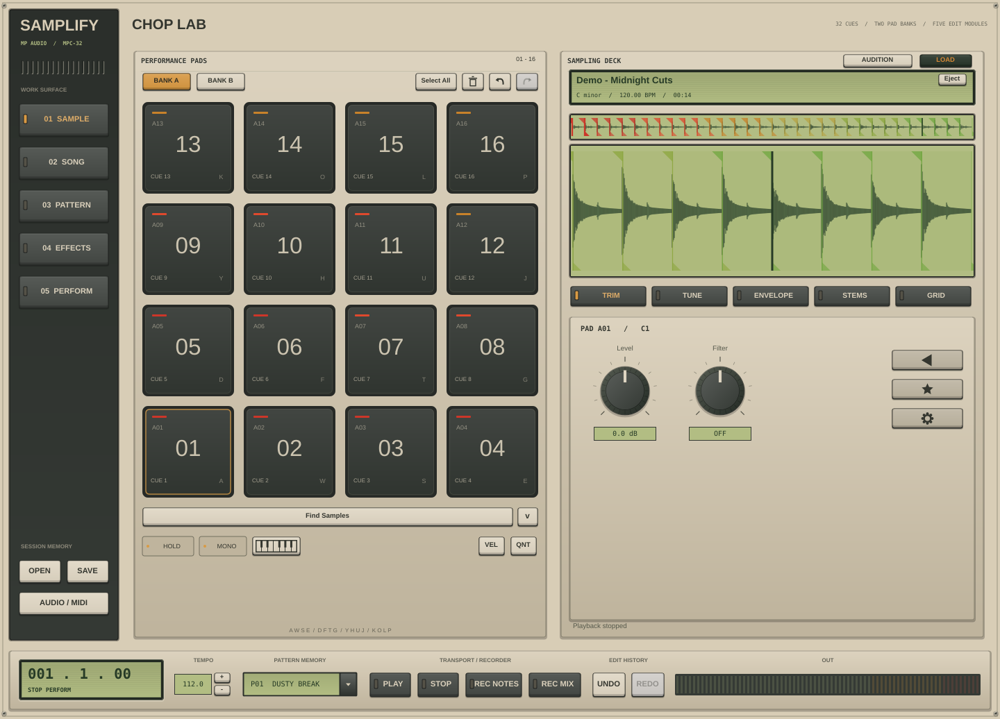

# Samplify by MP Audio

Samplify 0.2 is a standalone native macOS sampler built around the documented
Serato Sample 2.x interface and workflow: 32 cues, source audition and waveform
editing, five Autoset modes, chromatic performance, and four-stem isolation.
It uses JUCE 8/C++20, native HTDemucs separation, and Rubber Band pitch/time
processing under its own branding.



*Captured from the Linux validation build. Releases include native macOS
screenshots and the controller/stem workflow report.*

The [official Serato Sample manual](https://support.serato.com/hc/en-us/sections/115000138014-User-manual)
is the behavioral reference. The [reference and acceptance matrix](docs/SERATO_PARITY.md)
records the implementation, standalone adaptations, and comparisons still needed.
These independent engines do not establish identical sound or exact parity with
Serato's proprietary Stems and Pitch 'n Time processing.

## Download or build

The [deployment guide](docs/DEPLOYMENT.md) explains GitHub Actions downloads,
universal Apple Silicon/Intel ZIP and DMG packages, and signing. A successful
release workflow publishes the app with its native model already inside the
bundle. Development packages are ad-hoc signed; Developer ID signing and Apple
notarization require the credentials described in that guide.

To build and open the app locally, use macOS 12+, Xcode Command Line Tools, Git,
and CMake 3.28 or later:

```sh
./script/build_and_run.sh
```

The Codex **Run** action uses this script. On Apple Silicon, first-time model
preparation also needs Python 3.12. The script creates an isolated build-time
environment with pinned PyTorch and NumPy versions, downloads the official Meta
checkpoint, verifies its SHA-256, and converts it to the native model. Initial
configuration also downloads pinned native dependency sources.

An existing verified model avoids conversion. On Intel Macs, use the converted
model from a Samplify 0.2 release or its app bundle:

```sh
export SAMPLIFY_STEM_MODEL_FILE='/Applications/Samplify.app/Contents/Resources/ggml-model-htdemucs-4s-f16.bin'
./script/build_and_run.sh
```

The shipped app runs offline without Python, a DAW, an online account, or a
separate model download. Model preparation, checksums, packaging, and source
build overrides are detailed in [deployment instructions](docs/DEPLOYMENT.md).

## Sampling workflow

1. Choose **Load Audio File**, or drop WAV, AIFF, FLAC, or MP3 onto the window.
   Loading starts with 32 empty cues. Audition the source with **Space**, seek in
   the overview, and zoom into the detailed waveform.
2. Click an empty pad or play its assigned key to create a cue at the playhead.
   Drag its start and end handles to trim it. **Quantize** snaps cue boundaries
   to the 1/8-beat grid. Edit the beatgrid and tempo anchors when the detected
   grid needs correction.
3. Use **Autoset** to populate cues with **Find Samples**, **Set Slicer**,
   **Set Random**, **Key Shift Pad**, or embedded **Serato DJ** hotcues. Favorites
   survive Autoset. Slicer starts at the current playhead; Key Shift Pad starts
   from the selected cue.
4. Select one cue or a group and adjust level, filter, attack/release, key shift,
   time stretch, reverse, and output routing. Rename or favorite cues,
   drag to move/swap them, or Alt-drag to copy. Undo and redo retain 100 actions.
5. Choose **Hold** or **Trigger**, **Mono** or **Poly**, velocity, and keyboard
   mode for performance. Keyboard mode plays the selected cue chromatically;
   glide offers Trigger and Sustain behavior. Pitch/time processing keeps pitch
   and speed independent; bypass uses varispeed.
6. Click **Vocals**, **Melody**, **Bass**, or **Drums** to isolate a stem mix.
   The first use separates the source in a cancellable background task and
   caches aligned stems as unclipped 32-bit float WAV. Click to mute or Shift-click to solo. Stem choices can
   apply globally or to selected cues, and the waveform follows the audible mix.
7. Save a `.samplify` session, or export the selected cue or occupied bank as
   processed 24-bit WAV files.

The computer keyboard uses the piano-style sequence `A W S E D F T G Y H U J K O L P`
for the first 16 cue slots. MIDI notes **24–55** address all 32 slots; keyboard
mode instead transposes the selected cue. **Space** plays/pauses source audition,
**Command-Z / Command-Shift-Z** undo/redo, **Command-A** selects occupied cues,
**Delete** removes selected cues, and **+ / −** zoom the waveform. Use
**Audio / MIDI** to choose the hardware device and MIDI inputs.

## Native processing and file behavior

- Four-stem separation runs HTDemucs in native C++ through a pinned
  `demucs.cpp` backend. The approximately 84 MB model is bundled and verified.
  **Melody** is the model's “other” component; the four outputs retain the source
  sample rate, channel count, and frame alignment. Separation can take time and
  use substantial memory on long tracks. Its quality depends on the recording.
- Rubber Band handles independent pitch/time processing for cue playback,
  keyboard performance, and export. Extreme settings can produce artifacts.
  Source tempo/key estimates remain editable; key sync transposes roots rather
  than changing a major/minor quality.
- Source audio supports mono/stereo, 8–384 kHz, and up to 32 million frames.
  Waveform analysis covers the file; tempo/key analysis uses its first 120
  seconds. Review estimates on silence, syncopation, and changing-tempo material.
  WAV export clips values outside full scale.
- Sessions store settings and references to source/cached stem files, not
  embedded audio. Keep those files available when reopening a session. Version
  1 sessions migrate to the current schema with their former time-stretch
  values converted to playback speed.
- Serato DJ import reads embedded ID3 GEOB hotcues from MP3, ID3 chunks in
  AIFF/WAV, and `SERATO_MARKERS_V2` FLAC comments. Original cue indices are
  retained. Unsupported or missing metadata leaves that Autoset mode disabled;
  external Serato databases and every tag variant are not supported. MP3
  decoder-specific timing offsets are not guessed.
- Standalone project tempo replaces a DAW host clock. Cue output routing uses
  available hardware channel pairs, with WAV export for moving cues into a DAW.
  This target is an application, not an AU/VST3/AAX plug-in, and does not load
  proprietary Serato session/preset formats.

## Validate

With the native model prepared, configure and run the complete test set:

```sh
cmake -S . -B build -DCMAKE_BUILD_TYPE=Release -DBUILD_TESTING=ON \
  -DSAMPLIFY_STEM_MODEL_FILE="$SAMPLIFY_STEM_MODEL_FILE"
cmake --build build --parallel 2
ctest --test-dir build --timeout 900 --output-on-failure
```

The suites cover core DSP, cue editing, embedded metadata, Rubber Band
pitch/duration behavior, actual neural stem inference, and audio/MIDI/session
integration. Native macOS workflow checks open the real app, exercise controller
actions and separation, and capture screenshots plus a JSON report. A configured
workflow is not evidence of a passed run; inspect the matching Actions run and
its artifacts. Physical audio/MIDI devices and comparison against a running
Serato version still need their own acceptance checks.

Portable core tests can run without JUCE, a desktop, or the neural model:

```sh
cmake -S . -B build-core -DSAMPLIFY_BUILD_APP=OFF -DCMAKE_BUILD_TYPE=Release
cmake --build build-core --parallel 2
ctest --test-dir build-core --output-on-failure
```

This reduced configuration does not exercise the app, Rubber Band, or native
stem backend. See the [acceptance matrix](docs/SERATO_PARITY.md) and
[deployment guide](docs/DEPLOYMENT.md) for the complete validation path.

## Source and license

`src/core` contains analysis, cue editing, and processing; `src/audio` owns
decoding, voices, device/MIDI I/O, metadata, and sessions; `src/stems` contains
native separation; `src/ui` contains the workstation. JUCE, Rubber Band, Eigen,
native Demucs sources, and model artifacts are pinned by commit and/or SHA-256.
The original [blueprint](docs/BLUEPRINT.md) is retained as project history.

Samplify is GPL-3.0; see [LICENSE](LICENSE) and
[third-party notices](resources/THIRD_PARTY_NOTICES.md). Distribution includes
JUCE/Rubber Band GPL notices, Demucs/model MIT notices, and Eigen's MPL 2.0
notice. Closed-source redistribution requires appropriate commercial licenses
for dependencies that otherwise require GPL distribution.
